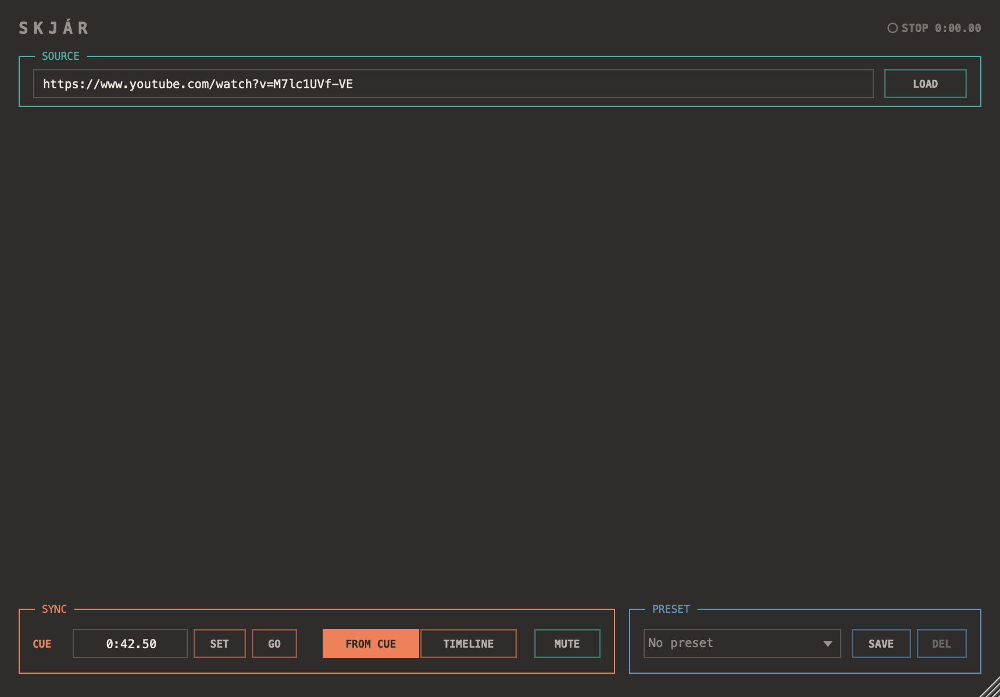

# Skjár

A YouTube video that follows the transport. VST3 / AU / standalone for macOS.

Paste a link, set a cue, press play in the host: the video starts from the cue.
Audio passes through untouched — put it on any track.



*(The picture is a native web view and does not show in the offscreen render.)*

## The panel

| | |
|---|---|
| teal — Source | the link, and Mute for the video's own sound |
| coral — Sync | the cue, and how the video follows the transport |
| steel — Preset | saving and recalling the other two |
| amber | the live transport state, and nothing else |

- **Load** (or Return) reads watch, youtu.be, shorts, embed, live and music
  links, or a bare video id. A link carrying `?t=` sets the cue too.
- **Cue** is typed as `m:ss.cc`, `h:mm:ss`, or plain seconds. **Set** takes the
  video's current position — scrub in the player to find it, then press Set.
  **Go** jumps the picture back to the cue.
- **From cue**: every time the transport starts, the video starts at the cue.
  A loop or a play head jump while running is a fresh start.
- **Timeline**: the cue lines up with the host's zero, so starting at bar 9
  plays the video from wherever bar 9 falls. Stopped, moving the host's play
  head moves the picture.

While running, the video is pulled back whenever it drifts more than 0.35 s
from where it should be.

The link, cue, sync mode and mute are saved with the host session. Presets are
one XML file each in `~/Library/Audio/Presets/Sungam/Skjar/`.

## Limits of this prototype

- The video only follows the transport while the plug-in window is open — the
  player lives in the editor.
- The video's sound comes out of the system output, not the plug-in's.
- Videos whose owners disable embedding will not play (the header says so).
- Sync is as close as YouTube's seeking allows: within a frame or two, not
  sample-accurate.

## Build

```sh
cmake -B build -G Xcode
cmake --build build --config Release
```

Needs JUCE at `/Applications/JUCE` (or `-DJUCE_DIR=...`). The build copies the
plug-ins into `~/Library/Audio/Plug-Ins/`.

`-DSKJAR_TOOLS=ON` adds two dev tools:

- `player_check [link]` — checks the link parser, and with a link, loads the
  real player in a WKWebView and checks that it parks, starts and seeks.
- `panel_shot [out.png]` — renders the editor to a PNG.
